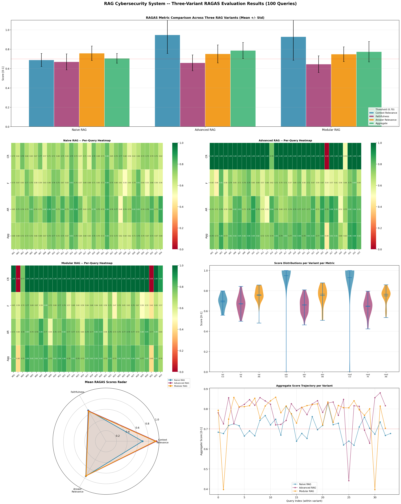
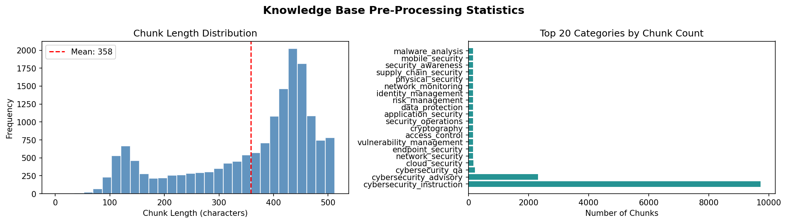

# RAG for Cybersecurity Practitioner Advisory: Naive vs Advanced vs Modular

A domain-specific **Retrieval-Augmented Generation (RAG)** system that turns practitioner questions about phishing detection, email security and incident response into three source-grounded guidelines. Three RAG architectures are built, run on the same LLM and prompt, and compared with RAGAS-style, reference-free metrics.

Built for *ARTI 6000: Advanced Topics in AI & Machine Learning* (University of Adelaide, Assignment 3).



## Pipeline

```
Practitioner query
   ├── Naive RAG     : bi-encoder (SBERT) → FAISS top-3 ─────────────────────────────┐
   ├── Advanced RAG  : bi-encoder → FAISS top-20 → cross-encoder re-rank → top-3 ─────┼─► Mistral-7B ─► 3 guidelines
   └── Modular RAG   : query expansion → FAISS top-30 + BM25 top-30 → RRF (k=60)      │
                       → cross-encoder re-rank → top-3 ───────────────────────────────┘
```

All three variants share the same LLM, prompt, temperature and token budget, so differences come from retrieval only.

## Knowledge base

About 8,000 cybersecurity passages (8,046 in the report) from five sources, covering 42 categories:

| Source | Description |
|---|---|
| Expert-curated NIST / CISA / ISO 27001 / MITRE ATT&CK passages | Hand-verified anchor layer (80 entries) |
| SecQA v1 + v2 | Peer-reviewed cybersecurity QA benchmark (210) |
| AlicanKiraz0 instruction dataset | Defensive instruction-response pairs (2,395) |
| Rowden / CybersecurityQAA | Expert-validated advisory QA pairs (1,562), needed a custom parser |
| Synthetic augmentation | Template-paraphrased standards text across 25 topics (3,750) |

Pre-processing: SHA-256 deduplication, then recursive chunking (512 characters, 64 overlap, mean chunk length about 358 characters).



## Models and tools

| Component | Choice |
|---|---|
| Embeddings | `all-mpnet-base-v2` (768-dim, L2-normalised) |
| Dense index | FAISS `IndexFlatIP` (exact search) |
| Sparse index | BM25Okapi (Modular RAG) |
| Re-ranker | `cross-encoder/ms-marco-MiniLM-L-12-v2` (Advanced and Modular RAG) |
| Generator | `Mistral-7B-Instruct-v0.3`, 4-bit NF4 quantisation, temperature 0.1, 800 max new tokens |
| Libraries | Python, PyTorch, Hugging Face Transformers, sentence-transformers, FAISS, rank-bm25, rouge-score, pandas, matplotlib |

## Evaluation

100 practitioner queries (34 Naive, 33 Advanced, 33 Modular), written to vary in specificity, practitioner role (SOC analyst, CISO, IT admin, compliance, SME), retrieval difficulty, sub-domain and scenario type. Three reference-free metrics, implemented from scratch:

| Metric | Idea |
|---|---|
| **Context Relevance (CR)** | Mean retrieval score of the top-3 chunks plus a category-diversity bonus |
| **Faithfulness (F)** | ROUGE-L / ROUGE-1 precision against the retrieved text plus max semantic similarity |
| **Answer Relevance (AR)** | Query–guideline embedding similarity plus a length-completeness term |
| **Aggregate** | Combined score, with 0.70 used as the quality threshold |

## Results

| Variant | Context Relevance | Faithfulness | Answer Relevance | Aggregate |
|---|---|---|---|---|
| Naive RAG | 0.690 ± 0.068 | 0.670 ± 0.083 | 0.759 ± 0.075 | 0.706 ± 0.051 |
| **Advanced RAG** | 0.949 ± 0.192 | 0.659 ± 0.082 | 0.752 ± 0.093 | **0.787 ± 0.083** |
| Modular RAG | 0.929 ± 0.244 | 0.646 ± 0.086 | 0.749 ± 0.076 | 0.775 ± 0.105 |

- Advanced RAG scored highest overall (t-test vs Naive p < 0.001). Modular RAG also beat Naive (p ≈ 0.001), but Modular vs Advanced was not significant (p ≈ 0.61).
- Faithfulness and Answer Relevance are almost identical across variants. Generation quality, not retrieval, drives them.
- 79% of all queries scored at or above 0.70 aggregate (42% at 0.80 or above). Only 7 of 100 had faithfulness below 0.55.
- Latency: retrieval takes 0.019 s (Naive), 0.042 s (Advanced) and 0.111 s (Modular). Generation is about 11–12 s per query for all.

## Repository contents

| File | Description |
|---|---|
| `RAG_Cybersecurity_Assignment_Final.ipynb` | Full pipeline: knowledge base, indexing, three RAG variants, evaluation, plots |
| `rag_evaluation_results_Final.csv` | Per-query metrics and generated guidelines (100 rows) |
| `rag_results_checkpoint.csv` | Raw generations saved before scoring |
| `RAG_A3_Report_Final.pdf` | Written report |
| `RAG_Cybersecurity_Presentation.pptx` | Presentation slides |
| `ragas_evaluation_dashboard.png` | Results dashboard |
| `chunk_distribution_Graphs.png` | Knowledge base statistics |

## How to run

1. Open the notebook in **Google Colab** with a GPU runtime. The report used an A100, and the 4-bit model also fits a T4.
2. Run the cells in order. The notebook installs its dependencies, builds the knowledge base and indexes, generates guidelines for each variant and writes the results CSVs.
3. Mistral-7B-Instruct-v0.3 is downloaded from Hugging Face, so you may need to accept its licence and add an `HF_TOKEN` in Colab secrets.

## Limitations

- **Different queries per variant.** Each variant was run on its own set of about 33 queries, not the same queries, so the comparison is not paired and query difficulty can affect it.
- **Context Relevance is not on one scale.** For the re-ranked variants it uses cross-encoder scores (roughly −3 to 7) clipped to 1, so about 90% of their CR scores are 1.0, while Naive CR uses cosine similarity. The headline CR gain is therefore partly a scoring artefact. Faithfulness and Answer Relevance are comparable across variants and show no real differences.
- **Reference-free proxy metrics.** These follow the RAGAS dimensions but are custom formulas (ROUGE and embedding similarity), not the RAGAS library or an LLM judge. ROUGE-based faithfulness can be satisfied by copying text.
- **Knowledge base imbalance.** `cybersecurity_instruction` is about 30% of chunks, phishing-specific categories are each under 1%, and about 47% of entries are synthetic.
- **Other limits.** English only, a static index that cannot reflect new CVEs, and 4-bit quantisation of the generator.

## Ethics and governance

The report applies the NIST AI RMF. Main risks are bias toward large US/EU enterprises, outdated advice, and hallucinated CVE identifiers. It proposes a three-tier human-in-the-loop model: automated output with citations for low-risk use, practitioner review for policy drafting, and certified-professional sign-off for incident response and regulatory use.

## Future work

Evaluate all variants on the same query set, use a common relevance scale (or the RAGAS library) for context relevance, add expert-written reference answers, rebalance the knowledge base toward phishing topics, and explore Self-RAG, GraphRAG and live CVE feeds.

## Author

Jaden Machado · [GitHub](https://github.com/Jaden449) · [LinkedIn](https://www.linkedin.com/in/jaden-machado-76ba33283)

